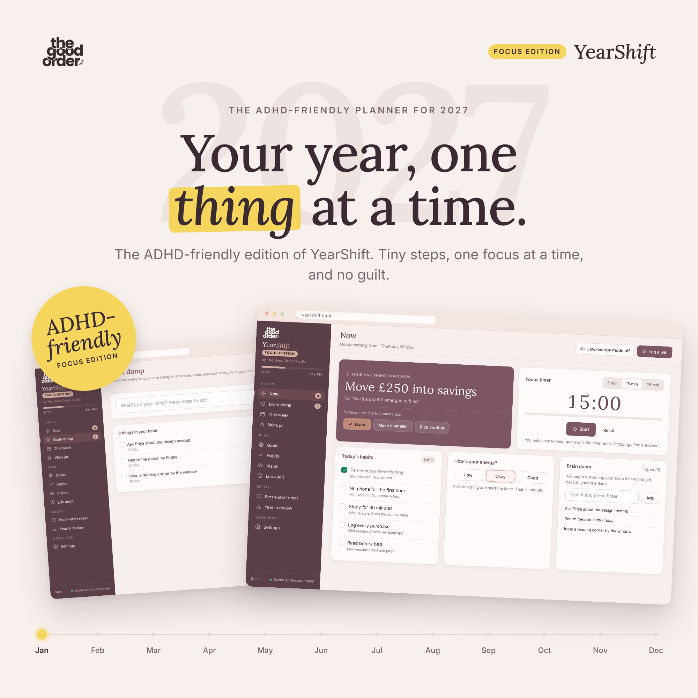
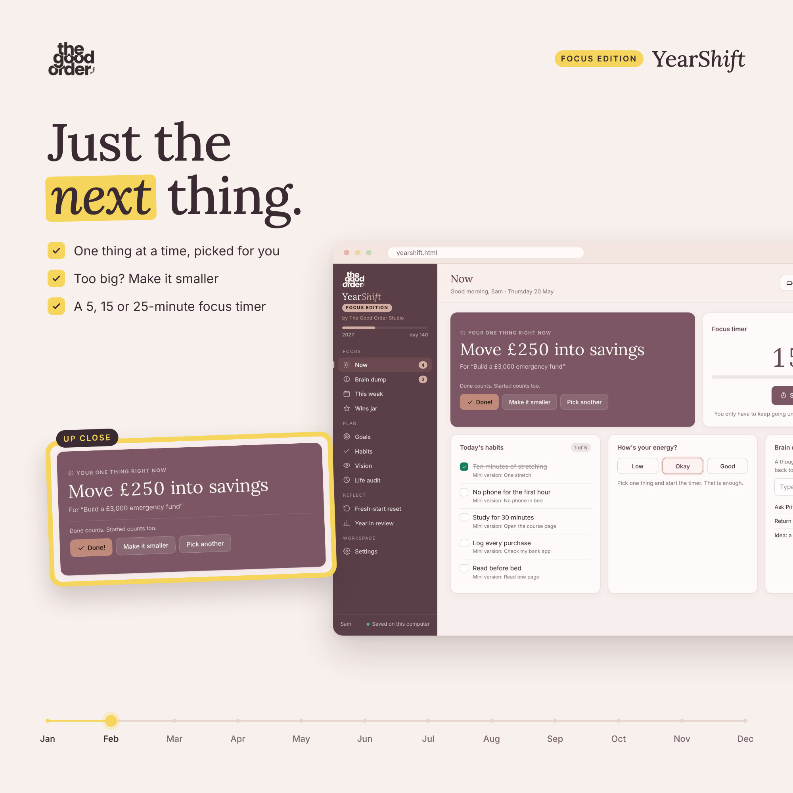
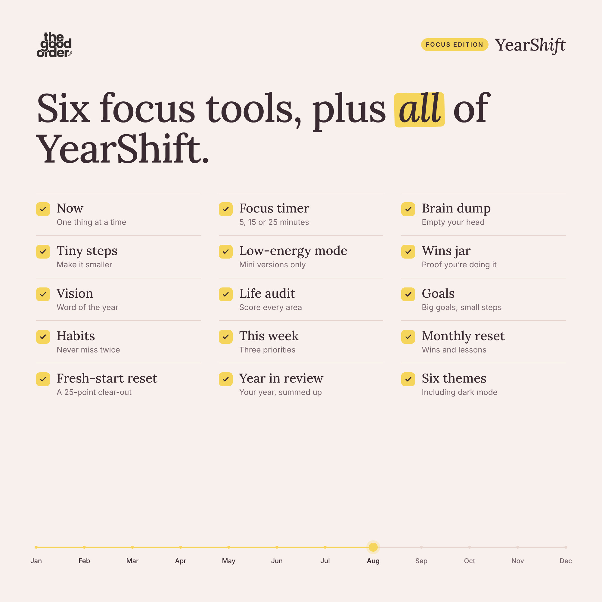

# YearShift Focus — free demo

your year, in focus.

This is the free demo of YearShift Focus by The Good Order Studio, the ADHD-friendly edition of YearShift: brain dumps, tiny next steps, a wins jar and gentle resets, with the full 2027 planner when you want it.

▶ Try it: https://thegoodorderstudio.github.io/yearshift-focus-demo/

- Explore a fictional sample year, already filled in
- Try Now, the brain dump, This week, the wins jar, goals broken into tiny steps, and habits
- Nothing to install, no account, and nothing is sent to a server
- Best on a computer, in Chrome, Edge, Firefox or Safari

The full version, with the step-by-step user guide, is available from The Good Order Studio.

---

© 2026 The Good Order Studio. All rights reserved.

YearShift Focus is original, copyrighted work. This demo is for trying YearShift Focus in your browser only. It is **not open source**: copying, modifying, reselling, rebranding, re-hosting or using it, its code or its images to make other products is not permitted. See [LICENSE](LICENSE).
